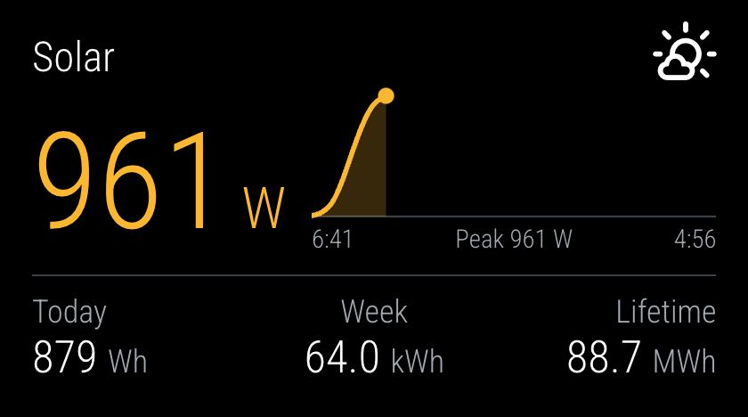

# MMM-EnphaseEnvoy

MagicMirror² module for an Enphase Envoy. Shows current power, a graph of today's production, and
today, week and lifetime totals, read from the Envoy's local `/production` page.

Only tested on an Envoy-C with firmware R3.7.26 (7888b3).



## Install

```sh
cd ~/MagicMirror/modules
git clone https://github.com/emlowe/MMM-EnphaseEnvoy
```

No npm dependencies.

## Config

```js
{
  module: "MMM-EnphaseEnvoy",
  position: "top_right",
  config: {
    hostname: "envoy.local", // Envoy host
    updateInterval: 300000,
    staleAfter: 3            // missed updates before the panel says data is old
  }
}
```

## Notes

- The graph runs from sunrise to sunset, taken from the stock `weather` module (6:00 to 18:00
  without one). Readings are saved to `history.json` and reset at midnight.
- The icon follows the `weather` module's current conditions.
- On a small display, hide the graph labels with `.solar-graph-labels { display: none; }`.
