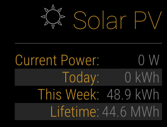

# MMM-EnphaseEnvoy
MagicMirror2 module for the Enphase Envoy. Pulls data directly from the envoy and scraps the HTML for production information. 
Only tested with Envoy-C with version R3.7.26 (7888b3) (old firmware)

## Daily power graph

The panel graphs today's power from sunrise to sunset. The node helper saves a reading at every update to `history.json` in the module folder and starts over at midnight. Each mirror keeps its own history, so the curve starts when the module is installed and shows a gap for any time the mirror was off.

Sunrise and sunset come from the `weather` module's current weather. Without one, the graph runs from 6:00 to 18:00, widened to fit the readings.

On a small display, hide the times and peak with `.solar-graph-labels { display: none; }` in `custom.css`.
